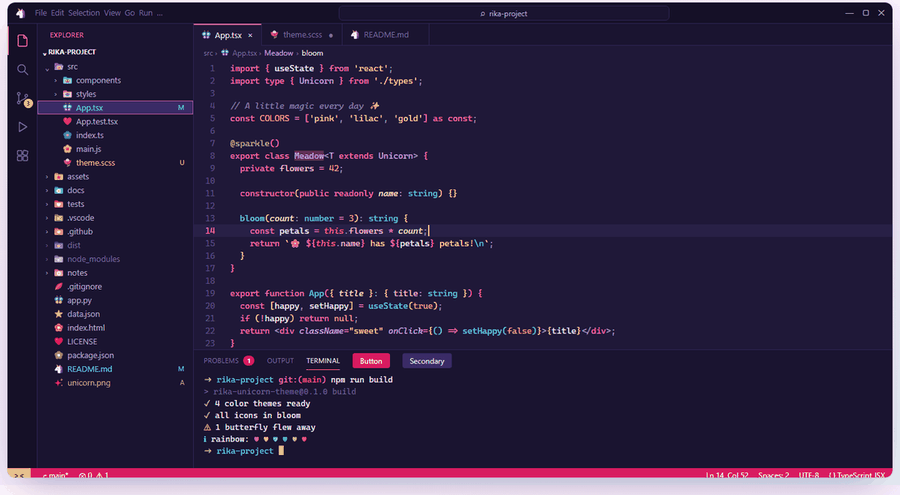
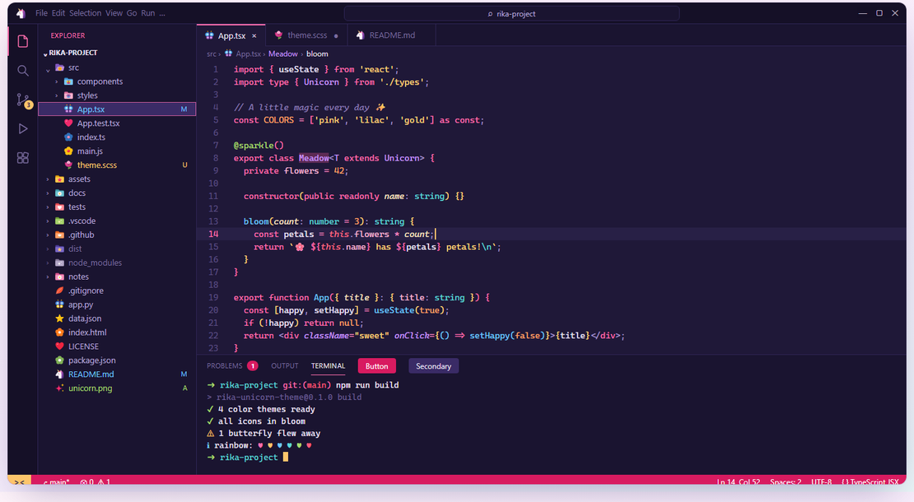
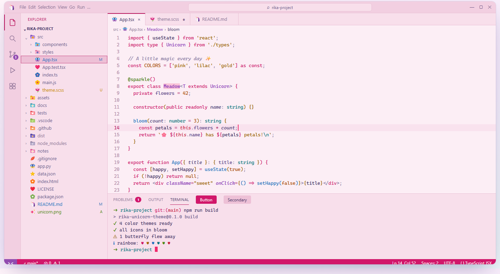
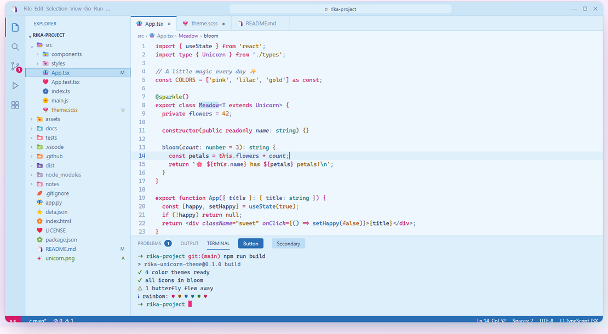
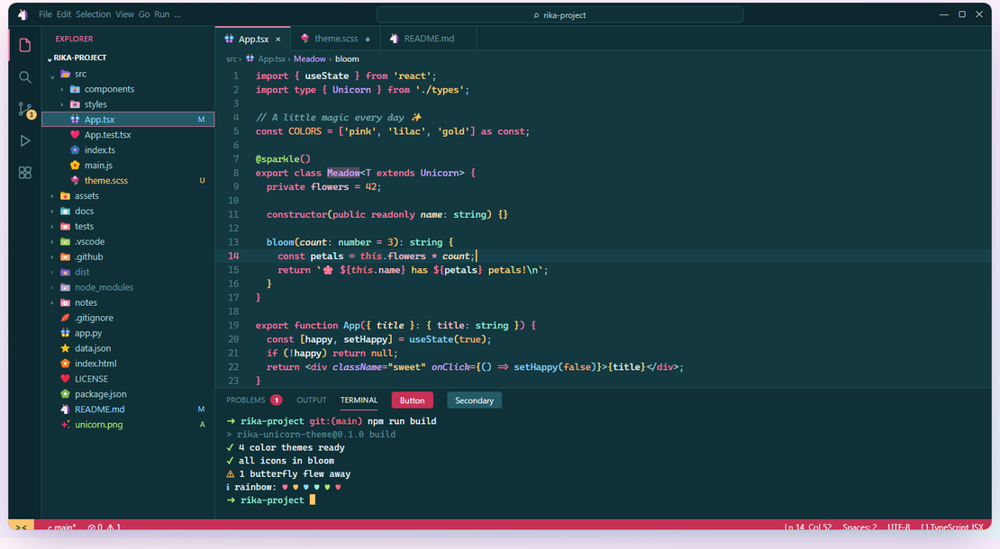
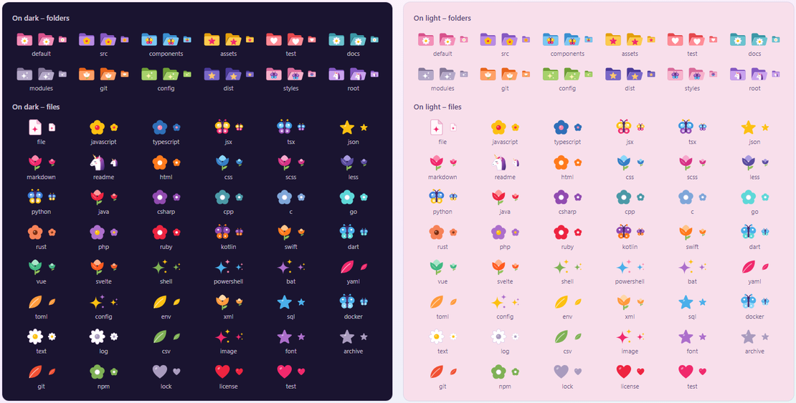

# Rika Unicorn Theme 🦄

Four color themes and a cute file icon theme for VS Code, colored from a unicorn, flowers and butterflies.

**[VS Code Marketplace](https://marketplace.visualstudio.com/items?itemName=mazsola739.rika-unicorn-theme)** · **[Showcase page](https://mazsola739.github.io/rika-unicorn-theme/)** · **[Download the .vsix](https://github.com/mazsola739/rika-unicorn-theme/releases/latest)**



## Themes

- **Rika Unicorn Dark**: midnight blue with pink and gold
- **Rika Unicorn Light**: soft pink
- **Rika Butterfly Sky**: light blue
- **Rika Sweet Teal**: teal with pink accents

Plus **Rika Unicorn Icons**: 71 file and folder icons (flowers, butterflies, stars, and a unicorn for README files).

Every theme has rainbow bracket pairs, matching terminal colors, and code colors checked for WCAG contrast.

## Install

In VS Code, open Extensions (`Ctrl+Shift+X`), search for **Rika Unicorn** and click **Install**. Or run:

```bash
code --install-extension mazsola739.rika-unicorn-theme
```

Then:

1. `Ctrl+K Ctrl+T` → pick a Rika theme
2. `Ctrl+Shift+P` → *File Icon Theme* → *Rika Unicorn Icons*

## Screenshots

| Dark | Light |
|---|---|
|  |  |
| **Butterfly Sky** | **Sweet Teal** |
|  |  |



## Tip: follow the system light/dark mode

```jsonc
"window.autoDetectColorScheme": true,
"workbench.preferredDarkColorTheme": "Rika Unicorn Dark",
"workbench.preferredLightColorTheme": "Rika Unicorn Light"
```

## Development

Colors live in `src/themes.mjs`, icons in `src/icons.mjs`.

```bash
npm run build      # themes, icons, preview/ and site/, plus a contrast check
npm run package    # build + .vsix
```
